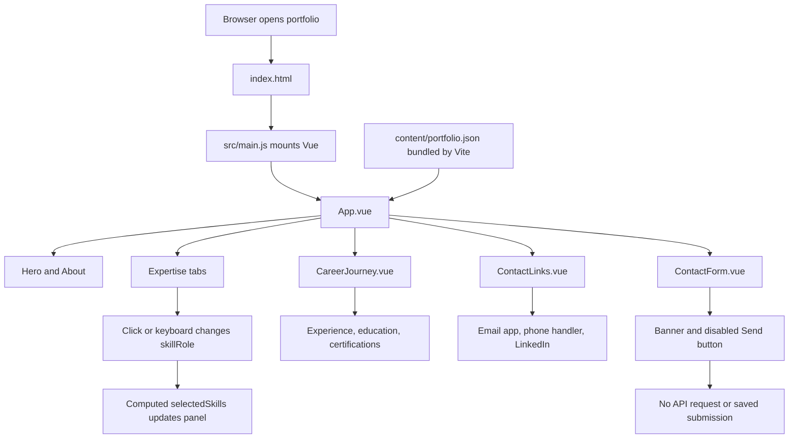

# Tanya's Portfolio

A frontend-first portfolio for hiring managers to explore Tanya's skills,
experience, education, certifications, and contact details.

**Stack:** Vue 3 Composition API, JavaScript, Tailwind CSS 4, Vite, and Lucide icons.
**Hosting:** static GitHub Pages deployment. No Python server, database, paid
service, or API credentials are required for the public site.

The uv-managed FastAPI backend is retained for optional local use and future
integration; it is not deployed to GitHub Pages.

## Quick Start

Use Node.js 22.12+ or a supported newer release. The deployment workflow uses Node.js 24.
Run these commands from the repository root:

```sh
npm --prefix frontend ci
npm --prefix frontend run dev -- --host 127.0.0.1 --port 5173
```

Open http://127.0.0.1:5173/. You do not need to start the Python backend.

To preview the production build:

```sh
npm --prefix frontend run build
npm --prefix frontend run preview -- --host 127.0.0.1 --port 5174
```

Open http://127.0.0.1:5174/. Use a static server or Vite preview, rather than opening
the built HTML directly with a `file://` URL.

## Frontend Flow



1. Vite builds the Vue application and imports public portfolio data directly into
	 its JavaScript bundle. There is no runtime `/api/portfolio` fetch.
2. `App.vue` composes the hero, About, Expertise, Journey, and Contact sections.
3. Expertise tabs update reactive `skillRole` state; `selectedSkills` derives the
	 active description and skill list. Arrow keys, Home, and End support navigation.
4. An `IntersectionObserver` tracks visible sections for navigation highlighting
	 and is disconnected when the page unmounts. The mobile menu has its own state.
5. `CareerJourney.vue` renders experience, education, and certification records.
	 The section is hidden when all three collections are empty.
6. Direct contact links remain usable. Form submission is disabled by default,
	 even if a submit event is triggered programmatically.

Navigation uses section anchors, not client-side page routes, so links such as
`#experience` do not require a server-side SPA fallback. The project-card and
data-demonstration sections are no longer part of the active page.

## Component Map

| File | Responsibility |
| --- | --- |
| [content/portfolio.json](content/portfolio.json) | Public biography, expertise, journey, credentials, and contact data |
| [frontend/src/main.js](frontend/src/main.js) | Imports global styles and mounts the Vue app |
| [frontend/src/App.vue](frontend/src/App.vue) | Page composition, navigation, expertise state, hero copy, and section labels |
| [frontend/src/components/CareerJourney.vue](frontend/src/components/CareerJourney.vue) | Experience, courses, degree details, recognition, and credential links |
| [frontend/src/components/ContactLinks.vue](frontend/src/components/ContactLinks.vue) | Email, telephone, and safe external LinkedIn links |
| [frontend/src/components/ContactForm.vue](frontend/src/components/ContactForm.vue) | Availability banner and retained, feature-gated submission logic |
| [frontend/src/lib/api.js](frontend/src/lib/api.js) | Request helper for future backend integration; not used to load the public portfolio |
| [frontend/src/portfolio.css](frontend/src/portfolio.css) | Tailwind import, typography, design tokens, responsive layouts, and reduced motion |
| [frontend/vite.config.js](frontend/vite.config.js) | Vue/Tailwind plugins, relative deployment base, and Vitest configuration |

## Editing Content

Update [content/portfolio.json](content/portfolio.json), then rebuild and redeploy:

- `about`: the personal introduction displayed in About.
- `roles`: expertise tab order, labels, descriptions, and skills. The default
	selected role is configured separately as `skillRole` in `App.vue`.
- `experience`: organization, role, period, category, location, and highlights.
- `education`: institution, degree/course, period, location, category, grade,
	and recognition. Optional details render only when present.
- `certifications`: title, issuer, category, verification flag, details, and URL.
- `contact`: email, LinkedIn URL, normalized telephone number, and display number.

Hero copy and other fixed headings live in `App.vue`. Some retained data fields,
such as `intro`, `headline`, `story`, and `projects`, are not currently rendered;
editing those fields alone does not change the active page.

Keep public content accurate. The four Salesforce certifications link to the
supplied official credential page. Agentblazer and Triple Star Ranger are separate
Trailhead achievements. The HK-dir recognition note applies only to the degree.
Do not put private documents, API keys, or other secrets in frontend data: anything
bundled into the site is public. Native Vue interpolation escapes displayed text.

## Contact Form

**Send message is currently unavailable.** A banner explains this, and the button
is greyed out and disabled. Fields are editable, but information stays in page
memory and is not sent or persisted. Email, phone, and LinkedIn are the available
contact channels.

The original submission code is preserved behind an `enabled` prop that defaults
to `false`. When enabled, it supports validation, loading state, a honeypot,
success feedback, and preservation of entered details after an error.

```vue
<!-- Future use only, after a working endpoint is connected -->
<ContactForm :enabled="true" />
```

Enabling the prop alone is not enough. The current helper sends to same-origin
`/api/contact`; GitHub Pages cannot serve that endpoint. Future integration needs
a hosted API or managed form service, appropriate endpoint configuration, and
privacy/spam controls. Never place email-service secrets in Vue or `VITE_*` values.
The retained Python endpoint saves submissions but does not send email.

## Quality Checks

```sh
npm --prefix frontend run lint
npm --prefix frontend run format:check
npm --prefix frontend test
npm --prefix frontend run build
```

Use `npm --prefix frontend run format` to apply formatting. Tests cover bundled
content with no API calls, expertise navigation, removed sections, journey details,
contact links, the unavailable form, and future enabled submission success/failure.
API-helper and project-filter tests are also retained for future use.

## GitHub Pages

1. Create a GitHub repository and push the project to its `main` branch.
2. In **Settings > Pages**, choose **GitHub Actions** as the source.
3. Push to `main`, or manually run **Deploy portfolio to GitHub Pages** in Actions.
4. Open the deployment URL shown by the completed workflow.

[.github/workflows/pages.yml](.github/workflows/pages.yml) installs dependencies
with `npm ci`, runs lint and tests, builds the frontend, uploads `frontend/dist`,
and deploys that artifact. It does not publish the backend or private files.

Vite's `base: './'`, `import.meta.env.BASE_URL` image path, and base-aware favicon
support both a user site and a project site:

```text
https://USERNAME.github.io/
https://USERNAME.github.io/REPOSITORY/
```

Publish the generated build through the workflow, not the source HTML. A public
repository can use GitHub Pages on GitHub Free, subject to GitHub's service limits.

## Optional Python Backend

For local API exploration, install uv and use Python 3.12+:

```sh
uv sync --locked
uv run uvicorn backend.main:app --reload --host 127.0.0.1 --port 8000
```

API documentation: http://127.0.0.1:8000/docs.

The application factory, SQLite persistence, input validation, CORS, trusted hosts,
and basic rate limiting live in [backend/main.py](backend/main.py). Pydantic schemas
are in [backend/models.py](backend/models.py). The static frontend does not execute
those schemas; the optional API validates content when its portfolio route is called.

```sh
uv run pytest
uv run ruff check backend
uv run ruff format --check backend
```

Configuration examples are in [.env.example](.env.example). Messages are stored
in `data/messages.db` by default, without a public inbox endpoint or email delivery.
Before exposing the API, configure HTTPS, origins/hosts, persistent storage, backups,
data retention, and request-size limits. The in-process rate limiter assumes one
worker; multiple replicas need shared rate limiting and suitable database storage.

Private DOCX text extraction is available for content preparation:

```sh
uv run -m backend.extract_cv resumes/*.docx
```

Review the original documents for embedded graphics or text boxes not extracted.
Do not publish unnecessary personal information. Resume files, database files, and
environment secrets should remain outside Git and outside the Pages artifact.

## Troubleshooting

- **Blank page after dependency changes:** restart Vite with
	`npm --prefix frontend run dev -- --force`, then hard-refresh the browser.
- **Missing Pages images or scripts:** check that the workflow deployed
	`frontend/dist` and that asset paths remain relative/base-aware.
- **Content changes not visible:** rebuild and redeploy; the public data is bundled,
	not fetched from a live backend.
- **Send button disabled:** intentional until a working submission service is connected.
- **Pages workflow not running:** confirm the branch is `main`, or use the manual
	trigger, and ensure Pages is configured to use GitHub Actions.

## Assets

The locally stored workspace photograph comes from Unsplash's image endpoint
`photo-1497215728101-856f4ea42174`; it is not a portrait of Tanya. Typography uses
DM Sans and Manrope through Google Fonts, with fallbacks. Self-host fonts when
offline operation or stricter privacy requirements matter. Review third-party
asset licensing before publication.